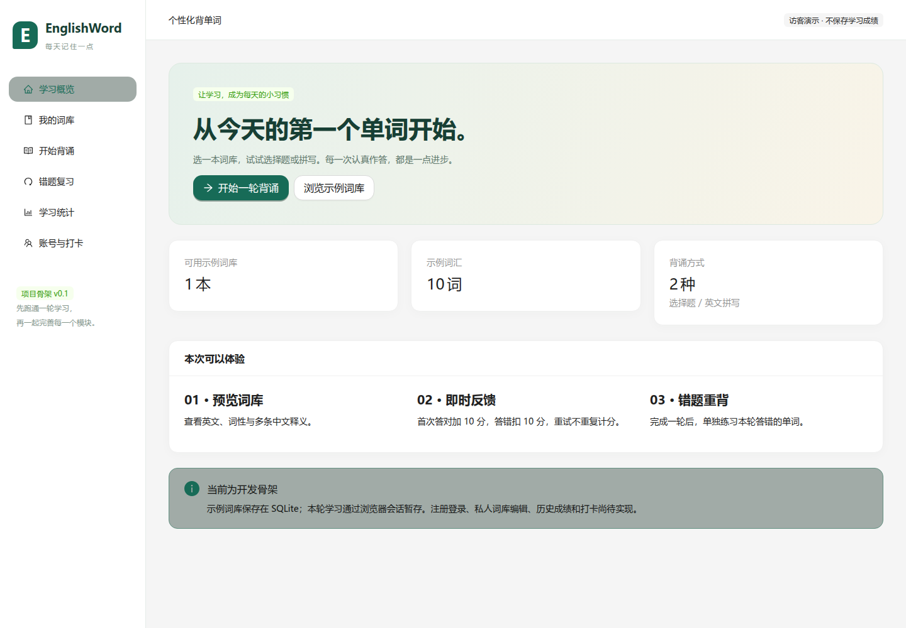

# EnglishWord · 个性化背单词

三人课程项目的可运行骨架。**前端固定 React，后端及背诵业务使用 C++17。**

技术栈：React + TypeScript + Vite + Ant Design + React Router + TanStack Query；C++17 + Drogon + SQLite + CMake。



## 当前进度

已实现：

- React 页面框架、侧边导航、词库表格、加载及错误提示。
- Drogon HTTP API、JSON 响应、浏览器 Cookie 会话。
- SQLite 首次迁移及持久化示例词库，十个单词，包含多释义样本。
- 看中文选英文、看中文拼写两种演示模式。
- 每题首次答对 +10、答错 −10，提示重试，重试不重复计分。
- 本轮错题重背，单个错词也可复习。
- 业务规则测试、数据库重启测试、真实 HTTP 集成测试和 GitHub Actions。

待开发：注册登录、用户数据隔离、私人词库维护和导入、看英文输入中文、历史成绩、持久化错题本、打卡。对应页面明确标注“待开发”，不会模拟完成。

**示例词库会写入 SQLite；背诵状态目前只放在 Drogon 会话中，闲置一小时或重启后端会丢失。** 这是一份开发起点，不是完整作业成品。C++ 与 React 混合语言是否符合课程要求，应按老师口径确认。

## 目录

```text
backend/
  src/core/           # 纯 C++ 业务：单词、判题、计分、错题
  src/controllers/    # Drogon 路由与请求校验
  src/repositories/   # 通过 Drogon 数据库客户端访问 SQLite
  db/migrations/      # 数据结构及版本迁移
  data/demo.tsv       # UTF-8 词库导入格式示例
frontend/
  src/pages/          # 学习概览、词库、背诵、复习、待开发页面
  src/lib/api.ts      # API 类型与请求封装
docs/                 # 分工计划、接口和架构
tests/                # C++ 单元测试与 Python HTTP 集成测试
```

## 本地开发

当前电脑的项目地址与可直接复制的启动命令见 [本地启动速查](docs/LOCAL.md)。

需要 C++17 编译器、CMake 3.24+、Node.js 22.12+ 和 Python 3（用于 HTTP 集成测试）。Windows 建议安装 Visual Studio 2022 Build Tools 的“使用 C++ 的桌面开发”，在开发者终端执行构建命令。前后端均不依赖 Qt。

### 1. 安装后端依赖

推荐使用 vcpkg，仓库已固定依赖基线，仅开启 Drogon SQLite 功能。首次构建会编译依赖，需要联网。

Windows PowerShell，在仓库根目录执行：

```powershell
git clone https://github.com/microsoft/vcpkg.git .tools/vcpkg
git -C .tools/vcpkg checkout ec48c11eae9448c8c6e7739d93e06fa2433aa95f
.\.tools\vcpkg\bootstrap-vcpkg.bat -disableMetrics
cmake --preset dev "-DCMAKE_TOOLCHAIN_FILE=$PWD/.tools/vcpkg/scripts/buildsystems/vcpkg.cmake"
cmake --build --preset dev --config Debug --parallel 2
ctest --preset dev -C Debug
```

Linux / WSL，在仓库根目录执行（先安装编译工具、Git、curl、zip、unzip、tar、pkg-config）：

```bash
git clone https://github.com/microsoft/vcpkg.git .tools/vcpkg
git -C .tools/vcpkg checkout ec48c11eae9448c8c6e7739d93e06fa2433aa95f
./.tools/vcpkg/bootstrap-vcpkg.sh -disableMetrics
cmake --preset dev -DCMAKE_TOOLCHAIN_FILE="$PWD/.tools/vcpkg/scripts/buildsystems/vcpkg.cmake"
cmake --build --preset dev --parallel 2
ctest --preset dev
```

如果系统已安装启用 SQLite 的 Drogon 开发包，直接运行 `cmake --preset dev` 即可；编译和测试命令不变。

### 2. 启动 C++ 后端

在仓库根目录执行：

```bash
# Linux / WSL，或使用单配置生成器的 Windows
./build/dev/backend/englishword_server --port 8080
```

Windows 使用 Visual Studio 多配置生成器时，可执行文件为：

```powershell
.\build\dev\backend\Debug\englishword_server.exe --port 8080
```

默认数据库：`build/runtime/englishword.sqlite`。启动时自动建表和导入示例，不会创建演示账号。可用 `--database 路径` 改变位置。`--help` 查看参数。

### 3. 启动 React 前端

另开终端：

```bash
cd frontend
npm ci
npm run dev
```

浏览器访问 [http://127.0.0.1:5173](http://127.0.0.1:5173)。Vite 将 `/api` 代理到 `127.0.0.1:8080`，浏览器无需配置跨域。请始终使用同一个浏览器地址，避免混用 localhost 与 127.0.0.1 导致 Cookie 不同。

## 检查与演示

```bash
# 无外部依赖也能验证纯 C++ 业务
cmake --preset core-only
cmake --build --preset core-only
ctest --preset core-only

# 前端类型检查及生产构建
cd frontend
npm run build
```

前端构建完成后，在仓库根目录启动后端并指定静态资源目录：

```bash
./build/dev/backend/englishword_server --web-root frontend/dist
```

此时访问 [http://127.0.0.1:8080](http://127.0.0.1:8080)，由同一个 C++ 服务提供前端和 API。前端使用 HashRouter，刷新页面不需要额外配置 SPA 回退。

## 三人接力

每人从 `main` 创建 `codex/模块名` 分支，每天提交可运行的小改动，通过 PR 合并。

- [一周分工与验收](docs/PLAN.md)
- [API 与待实现接口](docs/API.md)
- [数据库字段中文说明与表关系](docs/DATABASE.md)
- [业务例子与答辩口径](docs/BUSINESS.md)
- [本地地址与启动命令](docs/LOCAL.md)
- [架构、业务规则与扩展点](docs/ARCHITECTURE.md)

不提交数据库文件、账号密码、Token 或本机依赖目录。作业原始 PDF 不在公开仓库中。

## 官方资料

- [Drogon：路由、会话、数据库及代码生成工具](https://github.com/drogonframework/drogon)
- [React](https://react.dev/learn)
- [Ant Design 组件](https://ant.design/components/overview-cn/)
- [Vite](https://vite.dev/guide/)
- [TanStack Query](https://tanstack.com/query/latest/docs/framework/react/overview)

使用 Drogon 提供的基础设施与 Ant Design 提供的组件，团队主要编写课程业务。后续需要 CRUD 模型时，可安装 Drogon 的 `ctl` 功能，使用 `drogon_ctl` 生成控制器或数据库模型；当前骨架不依赖生成工具才能运行。
