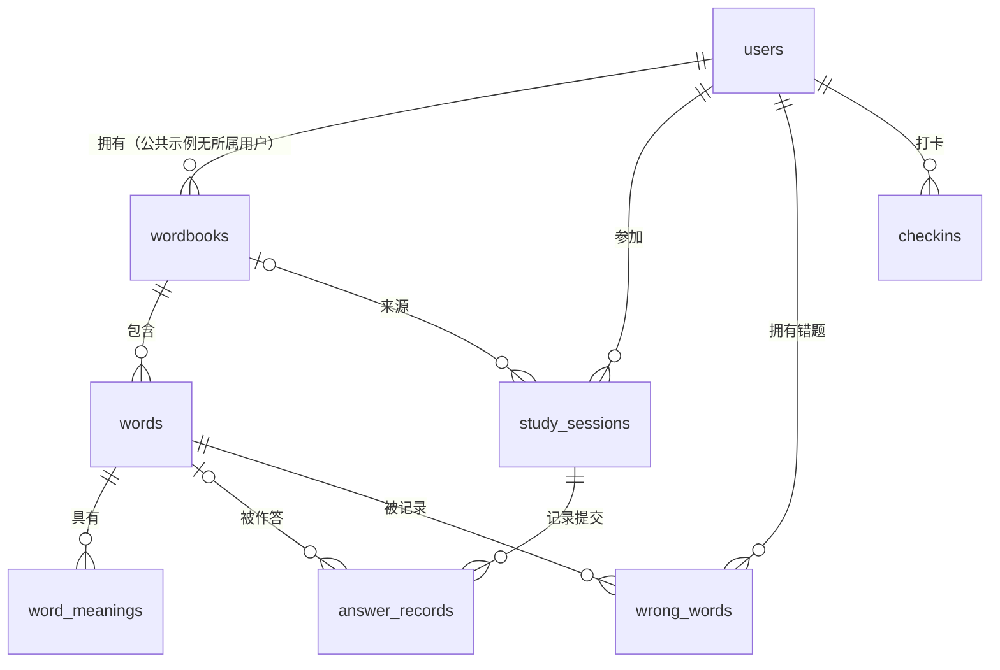

# 数据库速查

SQLite 文件默认在 `build/runtime/englishword.sqlite`。所有字段已在 [001_init.sql](../backend/db/migrations/001_init.sql) 标注中文注释。本次只加注释，没有修改表结构，不用删除已有数据库。

## 八张表分别做什么

| 表 | 中文含义 | 核心字段 / 业务用途 | 当前状态 |
| --- | --- | --- | --- |
| users | 用户 | id 用户编号、username 用户名、password_hash 密码验证串、created_at 注册时间 | 结构已建，注册待开发 |
| wordbooks | 词库 | id 词库编号、owner_user_id 所属用户、name 词库名称、created_at 创建时间 | 公共示例已使用 |
| words | 单词 | id 单词编号、wordbook_id 所属词库、english 英文、part_of_speech 词性 | 已使用 |
| word_meanings | 多条释义 | id 释义编号、word_id 所属单词、meaning 一条中文解释 | 已使用 |
| study_sessions | 每轮成绩汇总 | id 轮次编号、user_id 用户、wordbook_id 词库、mode 模式、score 分数、total_count 总题数、correct_count 首次对题数、started_at / finished_at 起止时间 | 写入待开发 |
| answer_records | 每次提交明细 | id 提交编号、session_id 所属轮次、word_id 单词、submitted_answer 输入、is_correct 是否答对、is_first_attempt 是否首次、score_delta 分数变化、created_at 提交时间 | 写入待开发 |
| wrong_words | 用户长期错题本 | user_id 用户、word_id 单词、wrong_count 首次答错轮次数、mastered 是否掌握、updated_at 更新时间 | 写入待开发 |
| checkins | 打卡 | user_id 用户、checkin_date 业务日期、created_at 实际提交时间 | 写入待开发 |

## 表之间的关系

## 五个答辩重点

1. **主键标识一条记录**：不能靠展示名称关联记录，用 users.id 等编号关联。
2. **外键关联对象**：words.wordbook_id 指向 wordbooks.id，不能给不存在的词库添加单词。
3. **联合唯一约束防重复**：words 的 `(wordbook_id, english)` 保证同一本词库不重复收录 apple；word_meanings 的 `(word_id, meaning)` 防重复释义。
4. **联合主键防止重复打卡累计**：checkins 的 `(user_id, checkin_date)` 不能重复；累计天数查该用户记录数，不用每点一次就加一。
5. **分开保存汇总和明细**：study_sessions 保存“本轮 80 分”，answer_records 解释“九题首次正确、一题首次错误”；wrong_words 保存跨轮次复习状态。

## API 字段如何对应数据库

| API 字段 | 数据库字段 / 计算方式 |
| --- | --- |
| Wordbook.id、start.wordbookId | wordbooks.id；单词关联字段为 words.wordbook_id |
| Word.id、Question.wordId | words.id |
| partOfSpeech | words.part_of_speech |
| meanings[] | 查 word_meanings 的多行 meaning，组装为数组 |
| Wordbook.wordCount | 对该词库 words 计数，不重复保存一份数量 |
| StudyState.score、correctCount、totalCount | 当前来自内存引擎；未来保存到 study_sessions 对应字段 |
| result.firstAttempt、scoreDelta、correct | 当前来自判题结果；未来保存到 answer_records 的 is_first_attempt、score_delta、is_correct |
| StudyState.wrongCount | 当前内存中的本轮错词数，**不等于** wrong_words.wrong_count 的跨轮次次数 |
| checkin.date、totalDays（草案） | checkins.checkin_date；按用户 COUNT(*) |

数据库布尔值用 0/1，API 用 false/true。CURRENT_TIMESTAMP 按 UTC 存储；打卡日期计划按 Asia/Shanghai 计算，不能直接把 UTC 日期当作本地打卡日期。

删除用户会级联删除其私人数据；删除词库会删除其中单词，但轮次的 wordbook_id 置 NULL，保留成绩。删除单词后明细的 word_id 也置 NULL，因此能保留成绩与输入，**不能完整还原已删除题目的原文**；将来需要历史试卷回放时，应在新迁移中增加题目快照字段。

数据库 study_sessions 是“一轮学习记录”，Drogon Session 是“浏览器临时会话”，两者不是同一个概念。数据库虽已建表，当前学习成绩尚未写入这些表。
